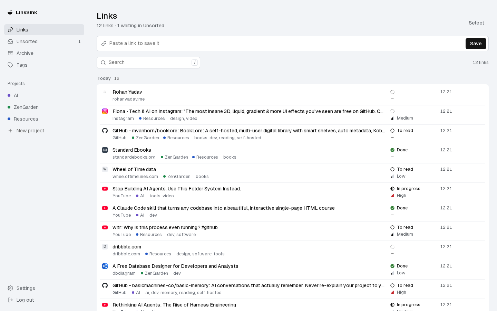
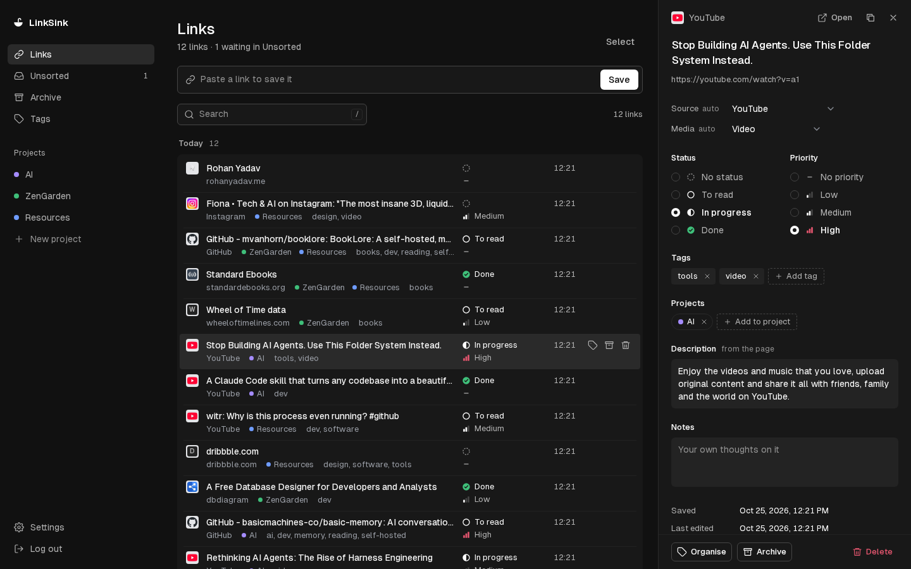

# LinkSink

[](https://github.com/LastStep/LinkSink/actions/workflows/ci.yml)
[](LICENSE)
[](https://buymeacoffee.com/trinetra)

**Paste any link and find it again later, organised your way.** LinkSink is a private, single-user home for the
links you save: paste one and its title, icon, preview, source and media type fill in by themselves; add tags,
projects, a status or a priority if you want; find it again in seconds. You host it yourself, with Docker.

Built with AI, in the open: [Claude](https://claude.com) ❤️ writes it. [How it is built](#built-with-claude).





## What it does today

- **Save in one paste.** Press Ctrl/Cmd+V anywhere in the app, or use the paste box. A link you already saved is
  shown to you instead of being saved twice.
- **Details fill in by themselves.** Title, description, site icon, preview image, **Source** (YouTube, GitHub, …,
  renamable) and **Media** (Video, Article, Post, Repo, Podcast, Image, PDF or Page), plus author, publish date and a
  video's length when the site gives them. Anything you edit stays yours: a later fetch never overwrites it. Pages
  are fetched carefully: an honest User-Agent, size and time limits, and no requests to private network addresses.
- **Organise your way.** Tags and projects (as many per link as you like), a status (To read, In progress, Done) and
  a priority (Low, Medium, High). Links with no tag and no project wait in **Unsorted**. Archive what you are done
  with; delete with undo; select many links and organise them at once.
- **Find it fast.** Search as you type across titles, addresses, descriptions, notes, tags and projects. Filter by
  source, media, tags (any or all), projects, status, priority and archive, and sort the list. Filters live in the
  address, so a view can be bookmarked.
- **Keyboard first.** `/` search, `n` paste box, `j` / `k` or the arrows move, Enter opens, `e` edit, `t` tags,
  `p` projects, `a` archive, `x` select, Ctrl/Cmd+K the command palette.
- **Bring your bookmarks.** Import a browser's bookmarks file (Chrome, Firefox and others, or a Raindrop, Pinboard
  or linkding export) or a Pocket CSV, with a preview where you choose what each folder becomes. Up to 20 MB and
  100,000 links per import. Export as a bookmarks file or as JSON.
- **Yours alone.** One account: sign-up closes once it exists. Email confirmation, rate-limited sign-in, HTTPS only.
- Light and dark themes, and a phone layout.

**Not yet:** working offline with sync across devices, sharing from a phone into LinkSink (an installable app and an
iOS Shortcut), automatic backups, and a board view and link map (being discussed). The plan is in
[`work/plans/P-T-0002.md`](work/plans/P-T-0002.md); where things stand is in [`.bonsai/STATE.md`](.bonsai/STATE.md).

## Host it

LinkSink runs as two containers: the app, and [Caddy](https://caddyserver.com) in front of it serving HTTPS (plain
http only redirects). Your account and links live in a Docker volume. Every push to `main` publishes the app's
image to `ghcr.io/laststep/linksink`, so a host needs no source code and builds nothing.

**You need** a machine with Docker and Docker Compose v2, and port 443 free (port 80 too, on a server).

### On a server, with a domain

1. Point a domain or subdomain (say `links.example.com`) at the server, and open ports 80 and 443.
2. Get the files LinkSink runs from, and its settings example as `.env`:

   ```bash
   mkdir -p ~/linksink/deploy && cd ~/linksink
   base=https://raw.githubusercontent.com/LastStep/LinkSink/main
   curl -fsSLo compose.yaml "$base/compose.yaml"
   curl -fsSLo deploy/Caddyfile "$base/deploy/Caddyfile"
   curl -fsSLo deploy/update.sh "$base/deploy/update.sh"
   curl -fsSLo .env "$base/deploy/server.env.example"
   ```

3. Fill in `.env`: `LINKSINK_HOST` (your domain), a new `LINKSINK_AUTH_SECRET` (`openssl rand -base64 32`), and
   your [Resend](https://resend.com) key and From address, which send the confirmation and password-reset emails.
4. Start it. The script pulls the image, starts both containers, waits until the app answers and checks
   `https://<your domain>/login`:

   ```bash
   sh deploy/update.sh
   ```

5. Open `https://links.example.com` and create your account. Caddy gets a certificate from Let's Encrypt by itself.

### Other ways to run it

- **On your own computer, to try it:** [`deploy/README.md`](deploy/README.md). It builds the image from this
  checkout and serves `https://localhost`, with the confirmation link printed to the log instead of emailed.
- **On another machine on your home network, with no domain,** moving your data from one machine to another, and
  deploying from GitHub Actions over SSH: [`deploy/SERVER.md`](deploy/SERVER.md).

### Update

```bash
sh deploy/update.sh
```

It pulls the newest image and restarts LinkSink; the app applies database changes itself when it starts. Pushes to
`main` can also deploy by themselves over SSH, once the deploy secrets are set ([`deploy/SERVER.md`](deploy/SERVER.md)).

### Settings

All in `.env` beside `compose.yaml`:

| Setting                   | What it is                                                                                                 |
| ------------------------- | ---------------------------------------------------------------------------------------------------------- |
| `LINKSINK_HOST`           | The host name LinkSink is served at, with no `https://`. `localhost` on your own computer.                 |
| `LINKSINK_LISTEN`         | The address ports 80 and 443 listen on: empty for every address, `127.0.0.1` for this machine only.        |
| `LINKSINK_HTTP_PORT`      | The port plain http redirects from: 80 on a server.                                                        |
| `LINKSINK_AUTH_SECRET`    | At least 32 random characters; sessions are signed with it. Changing it signs every device out.            |
| `LINKSINK_MAIL_TRANSPORT` | `resend` on a server; `console` prints mail to `docker compose logs app`, for trying it out only.          |
| `LINKSINK_RESEND_API_KEY` | Your Resend API key.                                                                                       |
| `LINKSINK_MAIL_FROM`      | The From address, on a domain verified with Resend.                                                        |
| `LINKSINK_IMAGE`          | The image to run: empty for `ghcr.io/laststep/linksink:latest`, or a version, commit or digest to stay on. |

### Backups

Automatic backups are not built yet. Until they are, export your links now and then (Settings → Export), or copy
the data volume as [`deploy/SERVER.md`](deploy/SERVER.md) shows.

## Develop

You need Node 22.19 or later and npm.

```bash
npm ci
cp .env.example .env          # then set BETTER_AUTH_SECRET: openssl rand -base64 32
npm run dev                   # http://localhost:5173; mail is printed in this terminal
```

The database is SQLite at `data/linksink.db`; migrations run when the server starts.

| Check           | Command                                                    |
| --------------- | ---------------------------------------------------------- |
| Types           | `npm run check`                                            |
| Lint and format | `npm run lint`                                             |
| Unit tests      | `npm run test:unit -- --run`                               |
| Browser tests   | `npx playwright install chromium`, then `npm run test:e2e` |
| Build and size  | `npm run build && npm run size`                            |

GitHub Actions runs the same checks on every push and pull request.

**Built with** SvelteKit 3 and Svelte 5 (adapter-node), Better Auth, SQLite with FTS5 (better-sqlite3, Drizzle),
Tailwind CSS 4, Caddy and Docker.

## Built with Claude

LinkSink is built with AI, and says so ❤️. [Claude](https://claude.com), Anthropic's AI, working in
[Claude Code](https://claude.com/claude-code), plans it, writes the code, the tests and these docs, and has each
piece of work checked by a separate reviewing agent before it lands. Its author decides what LinkSink should be,
approves the plans and the big decisions, and tries every change before it counts as done.

The work runs on [Bonsai](https://github.com/LastStep/Bonsai)'s workflow, and its whole record is in this
repository: what LinkSink is for in [`work/features/F-web-mvp.md`](work/features/F-web-mvp.md), the decisions in
[`work/decisions/`](work/decisions/), the tasks in [`work/tasks/`](work/tasks/), and what each piece of work did,
with its test results, in [`work/runs/`](work/runs/).

## Support

LinkSink is free. If it is useful to you and you want to say thanks, you can buy its author a coffee:

<a href="https://buymeacoffee.com/trinetra"></a>

## Security

LinkSink is private, not end-to-end encrypted: it keeps your links behind a sign-in and HTTPS on a machine you
control. To report a security problem, open a private advisory on this repository (Security → Report a
vulnerability) rather than an issue.

## Licence

LinkSink is free software under the [GNU Affero General Public License v3.0](LICENSE). You may use it, host it,
change it and share it. If you run a changed version for other people over a network, you must offer them its
source under the same licence.

Copyright (C) 2026 Rohan Yadav.
